# FERIA SEGURA HUAMANGA — Documentación Técnica de Base de Datos
## Modelo Entidad-Relación · Modelo Lógico · Modelo Físico · Diccionario de Datos
**Versión:** 1.0 | **PostgreSQL:** 16 | **Fecha:** 2026-11-02

---

## 1. MODELO ENTIDAD-RELACIÓN (MER)

```mermaid
erDiagram
    USUARIOS {
        UUID id_usuario PK
        VARCHAR identificador_login UK
        VARCHAR password_hash
        VARCHAR tipo_usuario
        VARCHAR estado_cuenta
        TIMESTAMPTZ ultimo_login
    }
    COMERCIANTE_PERFIL {
        UUID id_comerciante PK
        CHAR8 dni UK
        VARCHAR nombres
        VARCHAR apellidos
        VARCHAR estado_padron
        BOOLEAN coincide_padron_historico
    }
    FUNCIONARIO_PERFIL {
        UUID id_funcionario PK
        CHAR8 dni UK
        VARCHAR cargo
        VARCHAR area_municipal
    }
    ROLES {
        SERIAL id_rol PK
        VARCHAR nombre_rol UK
    }
    PERMISOS {
        SERIAL id_permiso PK
        VARCHAR codigo_permiso UK
        VARCHAR modulo
    }
    USUARIO_ROLES {
        UUID id_usuario FK
        INTEGER id_rol FK
        TIMESTAMPTZ fecha_asignacion
    }
    ROL_PERMISOS {
        INTEGER id_rol FK
        INTEGER id_permiso FK
    }
    RECURSO_ACL {
        BIGINT id_acl PK
        UUID id_usuario FK
        VARCHAR tipo_recurso
        UUID id_recurso
        BOOLEAN puede_leer
        BOOLEAN puede_escribir
        BOOLEAN puede_aprobar
    }
    SESION_TOKENS {
        UUID id_sesion PK
        UUID id_usuario FK
        VARCHAR token_hash UK
        INET ip_origen
        TIMESTAMPTZ expira_en
        BOOLEAN revocado
    }
    PADRON_HISTORICO {
        BIGINT id_padron PK
        CHAR8 dni
        VARCHAR nombres_completos
        SMALLINT anio_registro
    }
    GIROS_COMERCIALES {
        SERIAL id_giro PK
        VARCHAR nombre_giro UK
        BOOLEAN requiere_inspeccion_sanitaria
    }
    FERIAS {
        UUID id_feria PK
        VARCHAR codigo_feria UK
        VARCHAR nombre_feria
        DATE fecha_inicio
        DATE fecha_fin
        VARCHAR estado_feria
        UUID creado_por FK
    }
    SECTORES {
        UUID id_sector PK
        UUID id_feria FK
        VARCHAR codigo_sector
        NUMERIC capacidad_kw_maxima
        NUMERIC potencia_actual_calculada_kw
        BOOLEAN suministro_electrico_bloqueado
    }
    PUESTOS {
        UUID id_puesto PK
        UUID id_sector FK
        VARCHAR codigo_puesto
        NUMERIC ancho_metros
        NUMERIC largo_metros
        SMALLINT posicion_fila
        SMALLINT posicion_columna
        VARCHAR estado_puesto
        BOOLEAN es_zona_riesgo
        BIGINT version_lock
    }
    POSTULACIONES_RESERVAS {
        UUID id_reserva PK
        UUID id_feria FK
        UUID id_comerciante FK
        UUID id_puesto FK
        INTEGER id_giro FK
        TIMESTAMPTZ fecha_limite_pago
        VARCHAR estado_reserva
    }
    PAGOS_TUPA {
        UUID id_pago PK
        UUID id_reserva FK
        VARCHAR numero_operacion
        NUMERIC monto
        VARCHAR hash_comprobante
        VARCHAR estado_pago
        UUID validado_por FK
    }
    CREDENCIALES_AUTORIZACION {
        UUID id_autorizacion PK
        UUID id_reserva FK
        UUID codigo_qr_identificador UK
        TEXT firma_digital_qr
        VARCHAR estado_autorizacion
        UUID emitido_por FK
    }
    DECLARACIONES_ELECTRICAS {
        UUID id_declaracion PK
        UUID id_reserva FK
        BOOLEAN requiere_servicio_luz
        NUMERIC potencia_total_kw
    }
    ARTEFACTOS_CATALOGO {
        SERIAL id_artefacto PK
        VARCHAR nombre_artefacto UK
        NUMERIC potencia_referencial_watts
    }
    DETALLES_ARTEFACTOS {
        BIGINT id_detalle PK
        UUID id_declaracion FK
        INTEGER id_artefacto FK
        SMALLINT cantidad
        NUMERIC potencia_unitaria_kw
        NUMERIC potencia_subtotal_kw
    }
    MOTIVOS_INFRACCION {
        SERIAL id_motivo PK
        VARCHAR codigo_normativo UK
        VARCHAR gravedad
        NUMERIC monto_sancion
    }
    ACTAS_INFRACCION {
        UUID id_acta PK
        VARCHAR numero_acta_correlativo UK
        UUID id_puesto FK
        UUID id_comerciante FK
        INTEGER id_motivo FK
        UUID id_fiscalizador FK
        VARCHAR estado_acta
    }
    EVIDENCIAS_FOTOGRAFICAS {
        BIGINT id_evidencia PK
        UUID id_acta FK
        VARCHAR ruta_archivo_foto
        VARCHAR hash_archivo_sha256
    }
    AUDIT_LOG {
        BIGINT id_audit PK
        TIMESTAMPTZ fecha_hora
        UUID id_usuario_responsable FK
        INET ip_cliente
        VARCHAR tipo_operacion
        JSONB datos_anteriores
        JSONB datos_nuevos
    }

    USUARIOS ||--o| COMERCIANTE_PERFIL : "tiene perfil"
    USUARIOS ||--o| FUNCIONARIO_PERFIL : "tiene perfil"
    USUARIOS ||--o{ USUARIO_ROLES : "tiene roles"
    USUARIOS ||--o{ SESION_TOKENS : "tiene sesiones"
    USUARIOS ||--o{ RECURSO_ACL : "tiene ACL"
    USUARIOS ||--o{ AUDIT_LOG : "genera eventos"
    ROLES ||--o{ USUARIO_ROLES : "asignado a"
    ROLES ||--o{ ROL_PERMISOS : "incluye"
    PERMISOS ||--o{ ROL_PERMISOS : "pertenece a"
    FERIAS ||--o{ SECTORES : "divide en"
    SECTORES ||--o{ PUESTOS : "contiene"
    FERIAS ||--o{ POSTULACIONES_RESERVAS : "recibe"
    COMERCIANTE_PERFIL ||--o{ POSTULACIONES_RESERVAS : "realiza"
    PUESTOS ||--o| POSTULACIONES_RESERVAS : "es objeto de"
    GIROS_COMERCIALES ||--o{ POSTULACIONES_RESERVAS : "clasifica"
    POSTULACIONES_RESERVAS ||--o| PAGOS_TUPA : "tiene pago"
    POSTULACIONES_RESERVAS ||--o| CREDENCIALES_AUTORIZACION : "genera QR"
    POSTULACIONES_RESERVAS ||--o| DECLARACIONES_ELECTRICAS : "tiene declaracion"
    DECLARACIONES_ELECTRICAS ||--o{ DETALLES_ARTEFACTOS : "detalla"
    ARTEFACTOS_CATALOGO ||--o{ DETALLES_ARTEFACTOS : "referenciado en"
    COMERCIANTE_PERFIL ||--o{ ACTAS_INFRACCION : "recibe"
    PUESTOS ||--o{ ACTAS_INFRACCION : "genera"
    MOTIVOS_INFRACCION ||--o{ ACTAS_INFRACCION : "tipifica"
    ACTAS_INFRACCION ||--o{ EVIDENCIAS_FOTOGRAFICAS : "tiene"
```



---

## 2. MODELO LÓGICO — Relaciones y Cardinalidades

### 2.1 Esquema `auth_acl`

| Tabla origen | Cardinalidad | Tabla destino | Tipo FK |
|---|---|---|---|
| `usuarios` | 1:0..1 | `comerciante_perfil` | ON DELETE RESTRICT |
| `usuarios` | 1:0..1 | `funcionario_perfil` | ON DELETE RESTRICT |
| `usuarios` | 1:N | `usuario_roles` | ON DELETE CASCADE |
| `usuarios` | 1:N | `sesion_tokens` | ON DELETE CASCADE |
| `usuarios` | 1:N | `recurso_acl` | ON DELETE CASCADE |
| `roles` | M:N | `permisos` | vía `rol_permisos` |

### 2.2 Esquema `feria_core`

| Tabla origen | Cardinalidad | Tabla destino | Tipo FK |
|---|---|---|---|
| `ferias` | 1:N | `sectores` | ON DELETE RESTRICT |
| `sectores` | 1:N | `puestos` | ON DELETE RESTRICT |
| `ferias` | 1:N | `postulaciones_reservas` | ON DELETE RESTRICT |
| `comerciante_perfil` | 1:N | `postulaciones_reservas` | ON DELETE RESTRICT |
| `puestos` | 1:0..1 | `postulaciones_reservas` | ON DELETE RESTRICT |
| `postulaciones_reservas` | 1:0..1 | `pagos_tupa` | ON DELETE RESTRICT |
| `postulaciones_reservas` | 1:0..1 | `credenciales_autorizacion` | ON DELETE RESTRICT |
| `postulaciones_reservas` | 1:0..1 | `declaraciones_electricas` | ON DELETE RESTRICT |
| `declaraciones_electricas` | 1:N | `detalles_artefactos` | ON DELETE CASCADE |
| `actas_infraccion` | 1:N | `evidencias_fotograficas` | ON DELETE CASCADE |

### 2.3 Esquema `audit`

| Tabla origen | Cardinalidad | Tabla destino | Tipo FK |
|---|---|---|---|
| `audit_log` | N:0..1 | `usuarios` | ON DELETE RESTRICT (migración 008) |

---

## 3. MODELO FÍSICO

### 3.1 Inventario de Tablas

| Esquema | Tabla | PK | Propósito |
|---|---|---|---|
| auth_acl | usuarios | UUID | Punto único de autenticación centralizado |
| auth_acl | comerciante_perfil | UUID (FK) | Datos personales del comerciante |
| auth_acl | funcionario_perfil | UUID (FK) | Datos del funcionario municipal |
| auth_acl | roles | SERIAL | Catálogo de roles RBAC |
| auth_acl | permisos | SERIAL | Permisos atómicos por módulo |
| auth_acl | usuario_roles | PK compuesta | Asignación N:M usuario-rol |
| auth_acl | rol_permisos | PK compuesta | Asignación N:M rol-permiso |
| auth_acl | recurso_acl | BIGINT | ACL granular por instancia/recurso |
| auth_acl | sesion_tokens | UUID | Tokens de sesión y revocación |
| feria_core | padron_historico | BIGINT | Padrón histórico municipal (FSH-36) |
| feria_core | giros_comerciales | SERIAL | Catálogo de rubros comerciales |
| feria_core | ferias | UUID | Ferias temporales |
| feria_core | sectores | UUID | Sectores/vías zonificadas |
| feria_core | puestos | UUID | Puestos 2×2m con coordenadas |
| feria_core | postulaciones_reservas | UUID | Reservas y postulaciones |
| feria_core | pagos_tupa | UUID | Vouchers y validación TUPA |
| feria_core | credenciales_autorizacion | UUID | Credenciales municipales QR |
| feria_core | declaraciones_electricas | UUID | Declaración jurada eléctrica |
| feria_core | artefactos_catalogo | SERIAL | Catálogo de artefactos eléctricos |
| feria_core | detalles_artefactos | BIGINT | Artefactos declarados por reserva |
| feria_core | motivos_infraccion | SERIAL | Tipificación normativa de infracciones |
| feria_core | actas_infraccion | UUID | Actas levantadas en campo |
| feria_core | evidencias_fotograficas | BIGINT | Fotografías adjuntas al acta |
| audit | audit_log | BIGINT | Bitácora inmutable WORM |

### 3.2 Triggers

| Trigger | Tabla | Evento | Propósito |
|---|---|---|---|
| trg_audit_log_inmutable | audit.audit_log | BEFORE UPDATE/DELETE | Garantía WORM |
| trg_control_potencia_sector | feria_core.detalles_artefactos | BEFORE INSERT/UPDATE/DELETE | Límite 15 kW sector |
| trg_actualizar_declaracion_total | feria_core.detalles_artefactos | AFTER INSERT/UPDATE/DELETE | Suma kW declaración |
| trg_audit_pagos_tupa | feria_core.pagos_tupa | AFTER UPDATE | Auditoría aprobación pago |
| trg_audit_puestos | feria_core.puestos | AFTER UPDATE | Auditoría reasignación puesto |
| trg_audit_actas | feria_core.actas_infraccion | AFTER UPDATE | Auditoría anulación acta |
| trg_audit_roles | auth_acl.usuario_roles | AFTER INSERT | Auditoría asignación rol |

### 3.3 Funciones del Sistema

| Función | Esquema | Propósito |
|---|---|---|
| fn_validar_potencia_acumulada_sector() | feria_core | Control eléctrico con bloqueo pesimista FOR UPDATE |
| fn_actualizar_potencia_declaracion() | feria_core | Actualiza subtotal kW en declaración |
| sp_reservar_puesto_atomico(...) | feria_core | Reserva atómica serializada con FOR UPDATE |
| fn_proteger_inmutabilidad_audit_log() | audit | Trigger WORM - bloquea UPDATE/DELETE |
| fn_auditar_eventos_criticos() | audit | Captura eventos y los inserta en audit_log |
| fn_get_current_user_id() | auth_acl | Extrae UUID usuario de variable de sesión |
| fn_is_funcionario_interno() | auth_acl | Verifica si el usuario es funcionario |
| fn_has_area(area) | auth_acl | Verifica área municipal del funcionario |
| fn_has_permiso(codigo) | auth_acl | Verifica permiso RBAC del usuario |

### 3.4 Índices de Rendimiento

| Índice | Tabla | Columnas | Tipo | Jira |
|---|---|---|---|---|
| idx_uniq_comerciante_reserva_activa_por_feria | postulaciones_reservas | (id_feria, id_comerciante) WHERE activo | UNIQUE PARCIAL | FSH-14 |
| idx_puestos_disponibilidad_cuadricula | puestos | (id_sector, estado_puesto) INCLUDE(...) | COMPUESTO | FSH-32 |
| idx_credenciales_codigo_qr_lookup | credenciales_autorizacion | (codigo_qr_identificador) | UNIQUE | FSH-33 |
| idx_padron_historico_dni_lookup | padron_historico | (dni) | BTREE | FSH-36 |
| idx_rls_funcionario_id | funcionario_perfil | (id_funcionario, area_municipal) | BTREE | RLS |
| idx_audit_log_fecha_hora | audit_log | (fecha_hora DESC) | BTREE | FSH-31 |
| idx_audit_log_entidad | audit_log | (esquema, tabla, id_registro) | BTREE | FSH-31 |

---

## 4. DICCIONARIO DE DATOS

### 4.1 auth_acl.usuarios

| Columna | Tipo PostgreSQL | Nulable | Default | Descripción |
|---|---|---|---|---|
| id_usuario | UUID | NO | gen_random_uuid() | PK — Identificador único del usuario |
| identificador_login | VARCHAR(100) | NO | — | UK — DNI (comerciante) o usuario institucional (funcionario) |
| password_hash | VARCHAR(255) | NO | — | Hash bcrypt. Nunca en texto plano |
| tipo_usuario | VARCHAR(30) | NO | — | CHECK: COMERCIANTE o FUNCIONARIO_INTERNO |
| estado_cuenta | VARCHAR(20) | NO | 'HABILITADA' | CHECK: HABILITADA, DESHABILITADA, BLOQUEADA |
| ultimo_login | TIMESTAMPTZ | SÍ | NULL | Último inicio de sesión exitoso |
| creado_en | TIMESTAMPTZ | NO | clock_timestamp() | Fecha de creación |
| actualizado_en | TIMESTAMPTZ | NO | clock_timestamp() | Última modificación |

### 4.2 auth_acl.comerciante_perfil

| Columna | Tipo PostgreSQL | Nulable | Default | Descripción |
|---|---|---|---|---|
| id_comerciante | UUID | NO | — | PK/FK → usuarios. Extiende la entidad usuario |
| dni | CHAR(8) | NO | — | UK — DNI peruano 8 dígitos. CHECK regex |
| nombres | VARCHAR(100) | NO | — | Nombres conforme RENIEC |
| apellidos | VARCHAR(100) | NO | — | Apellidos completos |
| telefono | VARCHAR(15) | NO | — | Contacto 7-15 dígitos |
| domicilio | VARCHAR(255) | NO | — | Dirección del comerciante |
| estado_padron | VARCHAR(20) | NO | 'NUEVO' | CHECK: NUEVO, REGULAR, OBSERVADO |
| coincide_padron_historico | BOOLEAN | NO | FALSE | TRUE si el DNI figura en el padrón histórico (FSH-36) |
| actualizado_en | TIMESTAMPTZ | NO | clock_timestamp() | Última modificación |

### 4.3 auth_acl.funcionario_perfil

| Columna | Tipo PostgreSQL | Nulable | Default | Descripción |
|---|---|---|---|---|
| id_funcionario | UUID | NO | — | PK/FK → usuarios |
| dni | CHAR(8) | NO | — | UK — DNI del funcionario |
| nombres | VARCHAR(100) | NO | — | Nombres completos |
| apellidos | VARCHAR(100) | NO | — | Apellidos completos |
| cargo | VARCHAR(100) | NO | — | Cargo institucional |
| area_municipal | VARCHAR(50) | NO | — | CHECK: ADMINISTRACION, TESORERIA, DEFENSA_CIVIL, FISCALIZACION |
| actualizado_en | TIMESTAMPTZ | NO | clock_timestamp() | Última modificación |

### 4.4 feria_core.ferias

| Columna | Tipo PostgreSQL | Nulable | Default | Descripción |
|---|---|---|---|---|
| id_feria | UUID | NO | gen_random_uuid() | PK |
| codigo_feria | VARCHAR(30) | NO | — | UK — Ej: F-SEMANA-SANTA-2026 |
| nombre_feria | VARCHAR(150) | NO | — | Denominación oficial |
| descripcion | TEXT | NO | — | Descripción y objetivos |
| fecha_inicio | DATE | NO | — | Inicio de la feria |
| fecha_fin | DATE | NO | — | Cierre. CHECK fecha_fin >= fecha_inicio |
| ubicacion_referencia | VARCHAR(255) | NO | — | Referencia geográfica textual |
| estado_feria | VARCHAR(25) | NO | 'BORRADOR' | CHECK: BORRADOR, CONFIGURADA, CONVOCATORIA_ABIERTA, EN_EJECUCION, FINALIZADA |
| creado_por | UUID | NO | — | FK → usuarios. Administrador creador |
| creado_en | TIMESTAMPTZ | NO | clock_timestamp() | Fecha de creación |
| actualizado_en | TIMESTAMPTZ | NO | clock_timestamp() | Última modificación |

### 4.5 feria_core.sectores

| Columna | Tipo PostgreSQL | Nulable | Default | Descripción |
|---|---|---|---|---|
| id_sector | UUID | NO | gen_random_uuid() | PK |
| id_feria | UUID | NO | — | FK → ferias |
| codigo_sector | VARCHAR(20) | NO | — | UK compuesto con id_feria |
| nombre_via | VARCHAR(150) | NO | — | Nombre de la calle o vía |
| capacidad_kw_maxima | NUMERIC(6,2) | NO | 15.00 | Límite kW por Defensa Civil (FSH-16) |
| potencia_actual_calculada_kw | NUMERIC(6,2) | NO | 0.00 | Suma acumulada por trigger |
| suministro_electrico_bloqueado | BOOLEAN | NO | FALSE | TRUE al alcanzar límite máximo |
| creado_en | TIMESTAMPTZ | NO | clock_timestamp() | Fecha de creación |

### 4.6 feria_core.puestos

| Columna | Tipo PostgreSQL | Nulable | Default | Descripción |
|---|---|---|---|---|
| id_puesto | UUID | NO | gen_random_uuid() | PK |
| id_sector | UUID | NO | — | FK → sectores |
| codigo_puesto | VARCHAR(30) | NO | — | UK compuesto con id_sector |
| ancho_metros | NUMERIC(3,2) | NO | 2.00 | CHECK = 2.00 (FSH-26) |
| largo_metros | NUMERIC(3,2) | NO | 2.00 | CHECK = 2.00 (FSH-26) |
| posicion_fila | SMALLINT | NO | — | Fila en la cuadrícula |
| posicion_columna | SMALLINT | NO | — | Columna en la cuadrícula |
| estado_puesto | VARCHAR(20) | NO | 'DISPONIBLE' | CHECK: DISPONIBLE, RESERVADO, ASIGNADO, BLOQUEADO |
| es_zona_riesgo | BOOLEAN | NO | FALSE | Zona de hidrante/salida evacuación (FSH-28) |
| motivo_bloqueo | VARCHAR(50) | SÍ | NULL | CHECK: HIDRANTE_BOMBEROS, SALIDA_EVACUACION, etc. |
| bloqueado_por | UUID | SÍ | NULL | FK → usuarios |
| version_lock | BIGINT | NO | 0 | Control optimista de concurrencia |
| actualizado_en | TIMESTAMPTZ | NO | clock_timestamp() | Última modificación |

### 4.7 feria_core.postulaciones_reservas

| Columna | Tipo PostgreSQL | Nulable | Default | Descripción |
|---|---|---|---|---|
| id_reserva | UUID | NO | gen_random_uuid() | PK |
| id_feria | UUID | NO | — | FK → ferias |
| id_comerciante | UUID | NO | — | FK → comerciante_perfil |
| id_puesto | UUID | NO | — | FK → puestos |
| id_giro | INTEGER | NO | — | FK → giros_comerciales |
| fecha_reserva | TIMESTAMPTZ | NO | clock_timestamp() | Momento de la reserva |
| fecha_limite_pago | TIMESTAMPTZ | NO | — | TTL para adjuntar comprobante TUPA |
| estado_reserva | VARCHAR(25) | NO | 'RESERVADA' | CHECK: RESERVADA, EN_EVALUACION_PAGO, FORMALIZADA, EXPIRADA, CANCELADA |
| actualizado_en | TIMESTAMPTZ | NO | clock_timestamp() | Última modificación |

### 4.8 feria_core.pagos_tupa

| Columna | Tipo PostgreSQL | Nulable | Default | Descripción |
|---|---|---|---|---|
| id_pago | UUID | NO | gen_random_uuid() | PK |
| id_reserva | UUID | NO | — | FK/UK → postulaciones_reservas |
| numero_operacion | VARCHAR(50) | NO | — | Número bancario del voucher |
| monto | NUMERIC(8,2) | NO | — | CHECK > 0 |
| ruta_comprobante | VARCHAR(500) | NO | — | Ruta/URL del comprobante digital |
| hash_comprobante | VARCHAR(64) | NO | — | SHA-256 para verificar integridad |
| fecha_subida | TIMESTAMPTZ | NO | clock_timestamp() | Momento de carga del comprobante |
| estado_pago | VARCHAR(20) | NO | 'PENDIENTE' | CHECK: PENDIENTE, VALIDADO, RECHAZADO |
| observaciones_tesoreria | TEXT | SÍ | NULL | Comentarios del encargado de Tesorería |
| validado_por | UUID | SÍ | NULL | FK → funcionario_perfil |
| fecha_validacion | TIMESTAMPTZ | SÍ | NULL | Momento de validación por Tesorería |

### 4.9 feria_core.credenciales_autorizacion

| Columna | Tipo PostgreSQL | Nulable | Default | Descripción |
|---|---|---|---|---|
| id_autorizacion | UUID | NO | gen_random_uuid() | PK |
| id_reserva | UUID | NO | — | FK/UK → postulaciones_reservas |
| codigo_qr_identificador | UUID | NO | gen_random_uuid() | UK — UUID embebido en el QR físico |
| firma_digital_qr | TEXT | NO | — | Firma criptográfica del QR |
| estado_autorizacion | VARCHAR(20) | NO | 'APROBADA' | CHECK: PENDIENTE, APROBADA, VENCIDA, ANULADA |
| fecha_emision | TIMESTAMPTZ | NO | clock_timestamp() | Fecha de emisión |
| emitido_por | UUID | NO | — | FK → funcionario_perfil |

### 4.10 feria_core.declaraciones_electricas

| Columna | Tipo PostgreSQL | Nulable | Default | Descripción |
|---|---|---|---|---|
| id_declaracion | UUID | NO | gen_random_uuid() | PK |
| id_reserva | UUID | NO | — | FK/UK → postulaciones_reservas |
| requiere_servicio_luz | BOOLEAN | NO | TRUE | El comerciante requiere suministro eléctrico |
| potencia_total_kw | NUMERIC(6,3) | NO | 0.000 | Suma calculada por trigger |
| fecha_declaracion | TIMESTAMPTZ | NO | clock_timestamp() | Momento de la declaración |

### 4.11 feria_core.detalles_artefactos

| Columna | Tipo PostgreSQL | Nulable | Default | Descripción |
|---|---|---|---|---|
| id_detalle | BIGINT IDENTITY | NO | — | PK |
| id_declaracion | UUID | NO | — | FK → declaraciones_electricas |
| id_artefacto | INTEGER | NO | — | FK → artefactos_catalogo |
| cantidad | SMALLINT | NO | — | Unidades declaradas. CHECK > 0 |
| potencia_unitaria_kw | NUMERIC(6,3) | NO | — | kW por unidad. CHECK > 0 |
| potencia_subtotal_kw | NUMERIC(6,3) | NO | GENERATED | cantidad × potencia_unitaria_kw (columna calculada) |

### 4.12 feria_core.actas_infraccion

| Columna | Tipo PostgreSQL | Nulable | Default | Descripción |
|---|---|---|---|---|
| id_acta | UUID | NO | gen_random_uuid() | PK |
| numero_acta_correlativo | VARCHAR(50) | NO | — | UK — Número correlativo oficial |
| id_puesto | UUID | NO | — | FK → puestos |
| id_comerciante | UUID | NO | — | FK → comerciante_perfil |
| id_motivo | INTEGER | NO | — | FK → motivos_infraccion |
| id_fiscalizador | UUID | NO | — | FK → funcionario_perfil |
| fecha_hora_infraccion | TIMESTAMPTZ | NO | clock_timestamp() | Momento exacto de la infracción |
| observaciones_campo | TEXT | NO | — | Descripción detallada en campo |
| estado_acta | VARCHAR(20) | NO | 'REGISTRADA' | CHECK: REGISTRADA, NOTIFICADA, EN_DESCARGO, PAGADA, ANULADA |
| motivo_anulacion | TEXT | SÍ | NULL | Justificación de anulación |
| anulado_por | UUID | SÍ | NULL | FK → funcionario_perfil |
| fecha_anulacion | TIMESTAMPTZ | SÍ | NULL | Momento de anulación |

### 4.13 audit.audit_log

| Columna | Tipo PostgreSQL | Nulable | Default | Descripción |
|---|---|---|---|---|
| id_audit | BIGINT IDENTITY | NO | — | PK — Secuencia inmutable |
| fecha_hora | TIMESTAMPTZ | NO | clock_timestamp() | Marca temporal exacta del evento |
| id_usuario_responsable | UUID | SÍ | NULL | FK RESTRICT → usuarios. Actor del evento |
| ip_cliente | INET | SÍ | NULL | IP del cliente origen |
| esquema | VARCHAR(63) | NO | — | Esquema de la tabla afectada |
| tabla | VARCHAR(63) | NO | — | Tabla afectada |
| id_registro_afectado | TEXT | NO | — | Identificador de la fila afectada |
| tipo_operacion | VARCHAR(30) | NO | — | CHECK: INSERT, UPDATE, DELETE, APROBACION_PAGO, REASIGNACION_PUESTO, ANULACION_INFRACCION, ASIGNACION_ROL |
| datos_anteriores | JSONB | SÍ | NULL | Estado anterior (UPDATE/DELETE) |
| datos_nuevos | JSONB | SÍ | NULL | Estado nuevo (INSERT/UPDATE) |
| descripcion_evento | TEXT | SÍ | NULL | Descripción enriquecida del evento |

---

## 5. RESTRICCIONES DE INTEGRIDAD

| ID | Regla | Implementación |
|---|---|---|
| RN-01 | 1 reserva activa por comerciante por feria | UNIQUE INDEX PARCIAL WHERE estado activo |
| RN-02 | Puestos exactamente 2×2 metros | CHECK(ancho=2.00 AND largo=2.00) |
| RN-03 | Potencia sector no supera 15 kW | TRIGGER con FOR UPDATE pesimista |
| RN-04 | Auditoría inmutable WORM | TRIGGER + REVOKE UPDATE/DELETE/TRUNCATE |
| RN-05 | DNI único en el sistema | UNIQUE(dni) en comerciante_perfil y funcionario_perfil |
| RN-06 | DNI 8 dígitos numéricos | CHECK(dni ~ '^[0-9]{8}$') |
| RN-07 | No eliminar usuarios con auditoría | FK ON DELETE RESTRICT (migración 008) |
| RN-08 | fecha_fin >= fecha_inicio en feria | CHECK(fecha_fin >= fecha_inicio) |
| RN-09 | Monto TUPA positivo | CHECK(monto > 0) |
| RN-10 | Comerciante ve solo sus datos | RLS políticas (migración 009) |
| RN-11 | Vouchers TUPA confidenciales | RLS política p_rls_pagos_tupa |
| RN-12 | Coordenadas de cuadrícula positivas | CHECK(posicion_fila >= 0 AND posicion_columna >= 0) |

---

## 6. ORDEN DE EJECUCIÓN DE MIGRACIONES

```
001  → Extensiones pgcrypto, uuid-ossp y 3 esquemas
002  → Autenticación centralizada: usuarios, perfiles, RBAC, ACL, sesiones
003  → Dominio ferial: 14 tablas de negocio
004  → Auditoría WORM: audit_log + triggers de inmutabilidad
005  → Funciones de negocio: potencia eléctrica, reserva atómica, auditoría
006  → Índices: rendimiento < 500ms (FSH-32, FSH-33) + soporte FK
007  → Datos maestros: roles, permisos, giros, artefactos, motivos
008  → Corrección FK audit → usuarios: SET NULL → RESTRICT
009  → Row Level Security: funciones auxiliares + 8 políticas RLS
     → security/roles_and_grants.sql: rol app + grants + REVOKE
```

---

## 7. TRAZABILIDAD JIRA → MODELO

| Historia Jira | Entidad/Objeto |
|---|---|
| FSH-1, FSH-8 | ferias, sectores, puestos |
| FSH-2, FSH-36 | padron_historico, coincide_padron_historico |
| FSH-3, FSH-13, FSH-14, FSH-29 | postulaciones_reservas, sp_reservar_puesto_atomico, índice parcial |
| FSH-4, FSH-15 | declaraciones_electricas, detalles_artefactos, artefactos_catalogo |
| FSH-5, FSH-17, FSH-18 | pagos_tupa, trigger de aprobación |
| FSH-6, FSH-20, FSH-21 | actas_infraccion, motivos_infraccion, evidencias_fotograficas |
| FSH-9, FSH-26, FSH-28 | CHECK dimensiones 2x2, es_zona_riesgo, motivo_bloqueo |
| FSH-16, FSH-30 | fn_validar_potencia_acumulada_sector, capacidad_kw_maxima |
| FSH-19, FSH-20, FSH-33 | credenciales_autorizacion, codigo_qr_identificador, índice QR |
| FSH-22, FSH-36 | sesion_tokens, revocado |
| FSH-23, FSH-24, FSH-27 | roles, permisos, usuario_roles, rol_permisos, recurso_acl |
| FSH-25 | sectores.codigo_sector, zonificación vías |
| FSH-31 | audit_log, triggers WORM, fn_auditar_eventos_criticos |
| FSH-32 | idx_puestos_disponibilidad_cuadricula (< 500ms) |
| FSH-33 | idx_credenciales_codigo_qr_lookup (< 500ms) |
| FSH-34 | backup_base_wal.sh, postgresql.conf.wal, restore_pitr.sh |
| FSH-37 | pgbench scripts, sp_reservar_puesto_atomico (FOR UPDATE) |
